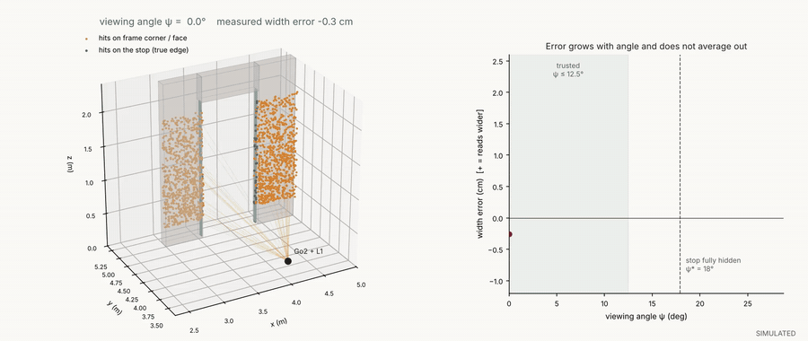
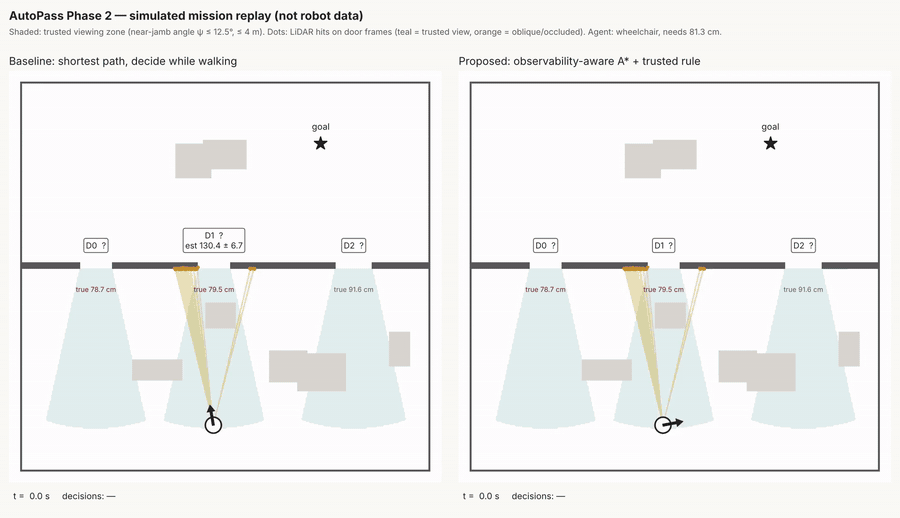
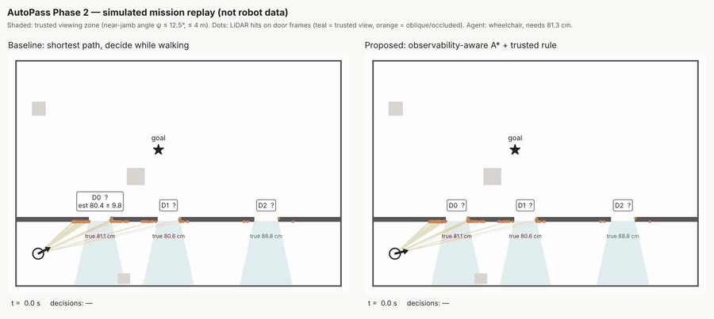

# AutoPass Phase 2 — Report 2 video supplement (simulated)

All three animations come from the AutoPass simulator, not from the robot. They play on this page; the original MP4 files are in this folder for download.

## Figure 1: why the viewing angle matters
The Go2 walks an arc 1.6 m from a steel door frame. Teal points land on the door stop (the true edge), orange points on the frame corner. Past about 15° the corner hides the stop and the opening reads wider. The error is a bias, so more scans from the same spot do not remove it; only a better viewpoint does.

## Figure 7: furnished room, world 1077
Left: shortest path, deciding while walking. A cabinet hides one jamb of D1, the robot reads it as wide enough and commits to a door that is 1.8 cm too narrow for a wheelchair. Right: observability-aware A* with the confidence rule goes straight to D2's trusted cone, confirms 91.2 cm (true 91.6 cm) and reaches the goal in 20 s.

## Extra: corridor, world 1001 (the cost of caution)
Left: the baseline reads D0 as 82.0 cm and commits; the door is really 81.1 cm, 0.15 cm too narrow. Right: the proposed method measures D0 and D1 from trusted views, finds both within 1 cm of the 81.3 cm requirement, flags them, and passes through D2. The safe route takes 51 s against 22 s.

Regenerate: `python -m autopass_sim.render_sweep`, `python -m autopass_sim.render2d --layout room --seed 1077`, `python -m autopass_sim.render2d --layout corridor --seed 1001`.
